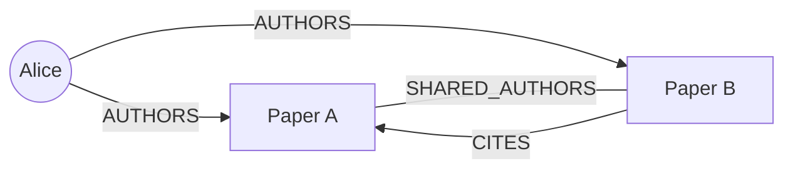
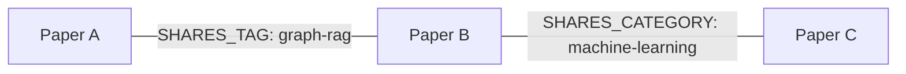

# ArXiv Curator — Requisiti e Piano di Azione

> Documento di contesto del progetto. Scopo: permettere a chiunque (umano o agente AI)
> di riprendere il lavoro da zero leggendo solo questo file. Aggiornarlo a ogni decisione
> architetturale rilevante e a ogni fase completata.

Ultimo aggiornamento: 2026-10-30 — Stato: **Ingestion ed enrichment implementati; bibliografia
da Scholar in batch con fallback OpenAlex, inclusi riferimenti esterni e metadati dei citati. HTML arXiv opzionale.
Due viste Obsidian concordate,
non ancora implementate. Primo graph builder Paper/CITES e task dedicato implementati,
verifica grafo sul workspace da completare. Embedding Gateway, snapshot Delta,
indice Lakebase/pgvector e setup automatico nella pipeline implementati; verifica remota da fare.
Assistente bibliografico read-only, App privata, tool e MCP implementati; primo deployment
App/Genie e verifica dei grant reali ancora da eseguire. MLflow rimandato su richiesta.**

---

## 1. Obiettivo del progetto

Sistema **agentico** (pipeline deterministica con **tool calling**) su Databricks che:

1. Riceve in input un **argomento** (query di ricerca) e dei **parametri**:
   - `num_papers`: numero N di paper da selezionare (top-N)
   - `ranking_criteria`: criterio di selezione — di default `relevance`, modificabile in
     `lastUpdatedDate` o `submittedDate` (con parametro `criteria_date` opzionale quando si filtra per data).
     *(Estensione futura: modulo separato per calcolare l'importanza tramite citazioni con tool esterni).*
2. Scarica da **arXiv** i top-N paper secondo il criterio (metadati + PDF).
3. Arricchisce i paper con un **LLM** via AI Gateway del corso (usando **tool calling / structured outputs** per estrarre tag tematici normalizzati, riassunto breve ed eventuali query/metadati).
4. Costruisce un **knowledge graph** che collega le entità tramite:
   - `SHARES_TAG`: collega paper che condividono tag LLM
   - `SHARES_CATEGORY`: collega paper che condividono categorie arXiv ufficiali
   - `CITES`: citazioni dirette tra paper (quando disponibili dai metadati/riferimenti)
   - `AUTHORS`: collega un nodo Autore (`Author`) al paper scritto (`Paper`)
   - `SHARED_AUTHORS`: collega paper che hanno uno o più co-autori in comune
5. Salva dati strutturati ed **embedding in Delta Tables** su Unity Catalog;
   pubblica i vettori precalcolati in **Lakebase PostgreSQL + pgvector standard (HNSW coseno)**.
6. Esporta nel **Volume Unity Catalog** due vault Obsidian autonomi (bibliografico e tematico),
   con un archivio `.zip` scaricabile contenente entrambi. I PDF saranno inclusi con link relativi.
7. Evoluzione concordata: assistente bibliografico che combina retrieval vettoriale e
   navigazione del grafo tramite tool controllati, riutilizzabili attraverso MCP.
   Questo livello interattivo non sostituisce la pipeline riproducibile o l'export autonomo.

### Estensibilità richiesta (design driver)

Il sistema deve essere pronto, senza refactoring strutturali, a supportare:

- **Altri indici bibliografici**: PubMed come primo esempio → pattern *provider* (`PaperSource`).
- **Calcolo importanza da citazioni**: modulo/tool separato aggiungibile in futuro per ri-ordinare o filtrare i paper in base all'impatto citazionale.
- **Ranking dei journal**: modulo di scoring separato che consuma i metadati raccolti.
- Nuovi criteri di selezione e nuovi tipi di nodi/edge nel grafo.

---

## 2. Vincoli: cosa NON toccare

- **Non modificare le versioni dell'ambiente**: `pyproject.toml` ha dipendenze pinnate e
  `requires-python = "==3.12.*"`. Aggiungere una dipendenza solo se strettamente necessaria
  e discuterla prima con l'utente; rigenerare `uv.lock` solo in quel caso.
- **Mantenere la struttura Databricks Asset Bundle**: `databricks.yml`, `resources/`,
  i tre target `dev`/`acc`/`prd` e il job `hello` esistente restano come sono.
  Le nuove risorse si **aggiungono**, non sostituiscono.
- Le regole ruff (`pyproject.toml`) e la CI (`.github/workflows/ci.yml`, pre-commit) restano
  attive: ogni nuovo codice deve passare lint + test.
- `project_config.yml` è la **fonte unica di verità** per catalog/schema/endpoint: mai
  hardcodare nomi di risorse nel codice, usare sempre `arxiv_curator.config.load_config`.
- `src/arxiv_curator/config.py` esiste già: non cambiarne l'API pubblica.
- Nota nota: `environment_version` è `"5"` in `pyproject.toml` e `"6"` in
  `resources/hello.job.yml`. Non "correggere": verificare col corso prima di toccarli.

### Risorse provisionate dal corso (da `project_config.yml` / README)

| Risorsa | Valore |
| --- | --- |
| Schemi UC | `llmops_{dev,acc,prd}.riccardo_tambone` (dev scrivibile; acc/prd read-only per me) |
| Volume suggerito | `arxiv_files` (da creare, es. `llmops_dev.riccardo_tambone.arxiv_files`) |
| LLM chat (AI Gateway) | `course_ops.gateway.chat` → GPT-OSS-120B, budget mensile per studente |
| Embeddings (AI Gateway) | `course_ops.gateway.embed` → GTE Large |
| SQL warehouse | `ce85f15d22846b60` |
| MLflow experiments | `/llmops/riccardo_tambone-{dev,acc,prd}` |
| Lakebase | `lb-llmops-riccardo-tambone`: progetto Autoscaling esistente condiviso; database `databricks_postgres`, schemi PostgreSQL `autographrs_{dev,acc,prd}`, scale-to-zero invariato |
| Indice vettoriale | pgvector `vector(n)` + HNSW `vector_cosine_ops`, tabella/indice separati per snapshot; nessuna abilitazione Lakebase Search |
| Usage/budget policy id | `891ab3b2-3b04-3ccb-8359-9327a16ef424` |

Chiamate ai modelli: pacchetto `openai` (già nelle deps) con base URL del workspace
`/ai-gateway/mlflow/v1` e auth Databricks. `databricks-openai` NON è nelle deps — valutare
prima di aggiungerlo.

### Dipendenze già disponibili (rilevanti per il progetto)

`arxiv==2.3.1`, `pydantic`, `loguru`, `backoff`, `mlflow`, `openai`, `databricks-sdk`,
`databricks-agents`, `psycopg[binary]` + `psycopg-pool` (per Lakebase/pgvector),
`databricks-vectorsearch`, `pandas`, `pyarrow`.

---

## 3. Criteri di selezione e gestione metadati

- **Criteri nativi supportati subito (arXiv API)**:
  - `relevance` (**default**): ordinamento per rilevanza di arXiv (`arxiv.SortCriterion.Relevance`).
  - `lastUpdatedDate`: ordinamento per data di ultimo aggiornamento (`arxiv.SortCriterion.LastUpdatedDate`), con possibilità di passare un parametro data (`date_from` / `date_to` o data di riferimento).
  - `submittedDate`: ordinamento per data di prima sottomissione (`arxiv.SortCriterion.SubmittedDate`), con possibilità di passare un parametro data.
- **Modulo futuro per citazioni / importanza**:
  - Predisporre l'interfaccia `CitationEnricher` / `ImportanceScorer` (es. via Semantic Scholar / OpenAlex) come tool opzionale per arricchire gli archi `CITES` e calcolare uno score di importanza in una fase successiva.
- **Mai inventare citazioni via LLM**: gli edge `CITES` devono derivare da riferimenti bibliografici
  verificabili. Menzioni di titoli o ID nell'abstract/commenti non sono sufficienti.

---

## 4. Architettura proposta (Pipeline deterministica + Tool Calling)

```text
┌─────────────────────────────────────────────────────────────────────┐
│                  JOB BUNDLE (parametrizzato, nuovo)                 │
│  query, num_papers, ranking_criteria (default: relevance),          │
│  target_date (opz.), env                                            │
└──────────────────────────────┬──────────────────────────────────────┘
                               ▼
┌─────────────────────────────────────────────────────────────────────┐
│  1. INGESTION — sources/ (pattern Provider + Tool)                  │
│     ArxivSource.search(query, criteria, top_n, target_date)         │
│     + download PDF → UC Volume arxiv_files                          │
│     + salvataggio metadati grezzi/normalizzati → Delta table        │
└──────────────────────────────┬──────────────────────────────────────┘
                               ▼
┌─────────────────────────────────────────────────────────────────────┐
│  2. AGENT / ENRICHMENT (Pipeline deterministica con Tool Calling)   │
│     - LLM (course_ops.gateway.chat) invoca tool strutturati per:    │
│       1) raffinare/costruire query e filtri (opz.)                  │
│       2) estrarre tag tematici normalizzati + riassunto per paper   │
│     - Embedding abstract (course_ops.gateway.embed → GTE Large)     │
│     Metadati/Tag/Vettori → Delta | Indice → Lakebase/pgvector       │
└──────────────────────────────┬──────────────────────────────────────┘
                               ▼
┌─────────────────────────────────────────────────────────────────────┐
│  3. GRAPH BUILDER — graph/                                          │
│     Nodi esportati: Paper e Author (bibliografico), Paper (tematico)│
│     Edge:                                                           │
│       - SHARES_TAG / SHARES_CATEGORY (paper ↔ paper)                │
│       - AUTHORS (author → paper)                                    │
│       - SHARED_AUTHORS (paper ↔ paper con co-autori comuni)         │
│       - CITES (paper → paper citato)                                │
│     Grafo materializzato in Delta tables (graph_nodes, graph_edges) │
└──────────────────────────────┬──────────────────────────────────────┘
                               ▼
┌─────────────────────────────────────────────────────────────────────┐
│  4. OBSIDIAN EXPORT — export/                                       │
│     - Note .md per Paper (frontmatter YAML con #tags + [[wikilinks]])│
│     - Due vault: bibliografico (paper/autori) e tematico (paper)    │
│     - Nessun graph.canvas (si usa il Graph View nativo di Obsidian) │
│     - UC Volume: due vault con PDF relativi + archivio .zip comune  │
└─────────────────────────────────────────────────────────────────────┘
```

### Struttura del package `src/autographrs/`

> Nota: `src/arxiv_curator/config.py` mantiene l'API del job `hello`, estesa con campi opzionali per embedding/ricerca e i test base del
> corso, mentre tutto il codice del nostro sistema vive in `src/autographrs/` (incluso nel wheel in
> `pyproject.toml`).

```text
autographrs/
├── config.py                # Re-export/wrapper di ProjectConfig, load_config, get_env
├── models.py                # Pydantic: Paper, Author, Tag, GraphNode, GraphEdge, SearchRequest
├── sources/
│   ├── base.py              # Protocol/ABC PaperSource (punto di estensione per PubMed, ecc.)
│   └── arxiv.py             # ArxivSource (relevance, lastUpdatedDate, submittedDate + filtro data)
├── enrichment/
│   ├── llm.py               # Client AI Gateway (chat + embeddings) + definizione Tools
│   ├── tagger.py            # Step deterministico con tool-calling per estrazione tag e summary
│   ├── citations.py         # Contratti e bibliografie; Scholar batch con retry e tutti i citati
│   ├── citation_service.py  # Scholar primario, OpenAlex se nessun riferimento; diagnostica separata
│   ├── arxiv_html.py        # Provider opzionale: bibliografia HTML ufficiale
│   ├── openalex.py          # Fallback: riferimenti e metadati citati da OpenAlex
│   ├── abstracts.py         # Titolo/abstract esterni in batch e classificazione del testo
│   ├── bibliography.py      # Snapshot Delta immutabili dei metadati esterni
│   └── prompts/             # (pianificato) System/user prompt versionati
├── storage/
│   └── delta.py             # Lettura/scrittura Delta tables su Unity Catalog
├── embeddings/
│   ├── models.py            # Documenti, hash, snapshot e registri pubblicazione
│   ├── gateway.py           # Client embedding del Gateway, batch e validazione
│   ├── storage.py           # Snapshot Delta e riuso vettori entro la run
│   ├── lakebase.py          # OAuth, setup vector/schema, transazioni e indici HNSW
│   └── search.py            # Registro Delta, barriere e retrieval per snapshot
├── assistant/
│   ├── models.py            # Contratti strict e binding a una raccolta approvata
│   ├── auth.py              # Identita' SQL delegata e isolata per richiesta, senza fallback
│   ├── sql.py               # Letture interattive parametrizzate via Warehouse, non Spark
│   ├── tools.py             # Servizi read-only condivisi tra agente e MCP
│   ├── genie.py             # Client MCP autenticato dello spazio Genie privato
│   ├── agent.py             # Loop Gateway con limiti di round/tool/token
│   ├── bootstrap.py         # Setup privilegiato: viste curate, Genie, ruoli/grant e manifest
│   ├── orchestration.py     # Handoff esecuzione figlia e stop/start/verifica della App
│   ├── web.py               # Databricks App privata: chat/API + Streamable HTTP MCP
│   └── ui.py                # Chat minimale, evidenze testuali, storico solo browser
├── graph/
│   ├── models.py            # Nodi Paper, archi CITES con evidenze, build e registro
│   ├── identity.py          # Alias esatti e quarantena delle componenti ambigue
│   ├── builder.py           # Builder puro: selezionati, esterni e placeholder; archi CITES
│   └── storage.py           # Snapshot Delta e pubblicazione indipendente dall'ingestion
├── export/
│   └── obsidian.py          # (pianificato) Formatter Markdown, due vault con PDF e ZIP
├── ranking/
│   ├── importance.py        # (ESTENSIONE FUTURA) calcolo importanza da citazioni
│   └── journals.py          # (ESTENSIONE FUTURA) scoring venue/journal
└── pipeline.py              # Orchestrazione deterministica dei passi 1→4, entrypoint del job
```

Decisione chiave: **`PaperSource` è il punto di estensione** — PubMed sarà
`PubMedSource(PaperSource)` senza toccare la pipeline. Allo stesso modo, `ranking/importance.py`
e `ranking/journals.py` potranno essere agganciati come step/tool aggiuntivi.

---

## 5. Data model e storage

| Cosa | Dove | Note |
| --- | --- | --- |
| PDF dei paper | UC Volume `arxiv_files` | `<volume>/runs/<run_id>/pdfs/<arxiv_id>.pdf` |
| Metadati paper | Delta table `papers` | `arxiv_id`, `title`, `authors`, `abstract`, `published`, `updated`, `categories`, `pdf_path`, `run_id` |
| Arricchimento | Delta table `paper_enrichment` | `paper_id`, `title`, `authors`, `tags` LLM, `arxiv_category` umanizzate, `summary`, `run_id`, citazioni e stato lookup |
| Nodi e Archi grafo | Delta tables `graph_nodes`, `graph_edges`, registro `graph_builds` | Primo incremento: Paper + `CITES`; autori e archi tematici futuri |
| Abstract dei citati | Delta tables `bibliography_metadata`, `bibliography_snapshots` | Metadati per nodo esterno, provenienza, diagnostica e variante testo; snapshot esplicito nel grafo |
| Embeddings | Delta `paper_embeddings_<model_key16>`, registro `embedding_snapshots` | Testo, vettore float32, variante, hash, endpoint/revisione e provenienza run/bibliografia |
| Indice ricerca | PostgreSQL `autographrs_<env>.e_<model_key16>_<snapshot_id>` + indice `_hnsw`; registro Delta `search_publications` | Copia operativa dei vettori, HNSW coseno; marker PostgreSQL `embedding_publications` e barriera Delta; backend/host/database/tabella espliciti |
| Vault Obsidian + ZIP (pianificati) | UC Volume `arxiv_files` | Due cartelle vault e archivio comune nel percorso isolato della run |

Ogni nuova ricerca ha un `run_id` (timestamp + slug argomento + UUID): lo stesso paper puo'
comparire in run diverse senza essere un duplicato logico. Lo storico resta nelle tabelle e nel Volume.

### Isolamento, pubblicazione e retry delle run (implementato)

- Registro Delta `pipeline_runs`, chiave `run_id`: parametri (`request_json`, source, opzioni),
  `attempt_id`, stato `RUNNING`/`COMPLETED`/`FAILED`, stati ingestion/enrichment/export,
  checkpoint `selection_complete`, conteggi paper/PDF/enrichment, warning, errore e timestamp.
  Percorsi vault/ZIP predisposti ma non ancora valorizzati; export `NOT_IMPLEMENTED`.
- `papers` e `paper_enrichment` sono scritte con `MERGE` e chiave `(run_id, source, paper_id)`.
  Aggiunta `source` all'enrichment; se manca nella tabella preesistente viene aggiunta prima
  del MERGE, poiche' una nuova colonna nella clausola ON richiede uno schema gia' compatibile.
- Deduplicazione delle righe sorgente identiche; duplicati conflittuali o storici respinti
  con errore esplicito, non riparati arbitrariamente. Nessuna cancellazione dello storico globale.
- Una run e' un singolo snapshot: i lettori filtrano `run_id` e abbinano `source`/`paper_id`.
  `load_papers`, `load_enrichments`, `load_run_dataset` verificano pubblicazione, unicita',
  conteggi, copertura esatta delle chiavi e ordine `rank`; vietate letture implicite di "ultima run".
- Il registro e' una barriera di pubblicazione, non una transazione multi-tabella: solo
  dopo tutte le scritture e le verifiche la run diventa `COMPLETED`. Eccezioni registrate e rilanciate.
- Run con citazioni non disponibili completabile con warning, conservando `citation_status`;
  PDF richiesti ma non scaricati fanno invece fallire la run. Enrichment disabilitato:
  `SKIPPED`, consultabile tramite `load_papers` ma non come dataset arricchito.
- Parametro job `run_id` vuoto: nuova ricerca. Valorizzato: retry di una run `FAILED` con
  gli stessi parametri/opzioni/fonte. Run sconosciute, completate o attive non sono riutilizzabili.
- Retry: riusa selezione finalizzata e PDF presenti, aggiorna le stesse chiavi; enrichment
  puo' richiamare LLM e provider. Se la selezione non era stata checkpointata, elimina solo
  le righe paper di quella run non pubblicata e rifà la ricerca.
- Job serializzato con `max_concurrent_runs: 1`; checkpoint condizionati all'`attempt_id`
  attivo. Non eseguire writer esterni concorrenti sullo stesso ID: Delta non impone unicita'
  delle chiavi. Interruzioni forzate possono lasciare `RUNNING`; nessun recupero automatico
  che rischi di rubare una run attiva. Riconciliare solo dopo aver verificato il job terminato.
- Le run precedenti senza registro non vengono implicitamente pubblicate o migrate.
  Per la prova creare una nuova run. Il notebook verifica anche la rilettura del dataset pubblicato.

### Output concordato: dataset comune, due proiezioni Obsidian

Questa decisione sostituisce la precedente proposta di vault unico con nodi Tag.
L'utente sceglie la visualizzazione aprendo il vault corrispondente, senza plugin o Canvas.

```text
output.zip
  bibliographic_vault/
    index.md
    papers/
    authors/
    attachments/
  thematic_vault/
    index.md
    papers/
    attachments/
```

**Vista bibliografica / collaborazioni:**

- Nodi Paper e Autore.
- `AUTHORS`: Autore -> Paper, identita' degli autori basata su ID affidabili quando disponibili;
  un match solo sul nome resta un'associazione non disambiguata, non una certezza.
- `SHARED_AUTHORS`: Paper -- Paper, con elenco degli autori condivisi come evidenza.
- `CITES`: Paper citante -> Paper citato, mai un arco inverso inventato.
- Grafo bibliografico aperto: includere anche i citati fuori dalla selezione e da arXiv,
  usando `bibliography`; `num_papers` limita soltanto i paper iniziali.
  Voci prive di identita' certa mantengono un placeholder distinto e il testo originale.
  Nessun download/LLM o espansione ricorsiva automatica sui riferimenti esterni.
- Scopo: esplorare collaborazioni, continuita' tra lavori e dipendenze bibliografiche.
- Sezioni delle note: Autori, Paper con autori condivisi, Cita e Citato da.



**Vista tematica:**

- Nodi Paper; link diretti Paper -- Paper tramite `SHARES_TAG` e `SHARES_CATEGORY`.
- Ogni arco conserva i tag/categorie condivisi e il loro conteggio, per spiegare il collegamento.
- `tags` contiene solo temi estratti dall'LLM; `arxiv_category` solo categorie arXiv umanizzate
  usando la tassonomia ufficiale. Non mescolare le due colonne.
- Conservare separati i tipi di arco per consentire esportazioni per tag, categorie o entrambe.
- Nessuna nota Tag/Categoria dedicata in questa vista: i temi restano proprieta' delle note.
  I tag nativi possono essere nascosti nel Graph View per mantenere i paper come nodi principali.
- Valutare limiti/filtro per categorie molto generiche, evitando un grafo tutto-connesso.



**Formattazione comune delle note (da implementare):**

- Una funzione deterministica genera frontmatter YAML e corpo Markdown da dati strutturati.
- Includere titolo, identificatore stabile, autori, date, fonte, DOI/URL, abstract originale,
  summary LLM separata e chiaramente marcata, tag e categorie distinti, link relativo al PDF.
- Stesso paper/metadati nei due vault; cambiano solo le sezioni e i collegamenti della vista.
- Nessun `key_contributions`. PDF inclusi in ogni vault per renderlo autonomo sul PC.
- Nomi file stabili e sanificati, collisioni gestite tramite identificatori.
- Pubblicazione completa dopo generazione riuscita e ZIP scaricabile dal Volume UC.
- Il Graph View nativo non mostra automaticamente etichette/tipi di relazione sugli archi.
  Direzione ed evidenze devono restare esplicite nelle note e nelle tabelle.
- Attenzione alla sezione "Citato da": inserire il wikilink inverso crea un ulteriore link
  Obsidian. Decidere in fase export se usare backlink nativi per non suggerire citazioni inverse.
- Anche indice, PDF e proprieta' con wikilink possono aggiungere nodi al Graph View:
  predisporre filtri per mostrare i soli tipi utili all'analisi.

### Citazioni: Scholar batch, fallback OpenAlex e bibliografia aperta (implementato)

- Contratto paper-aware `fetch_for_paper(Paper)`: il resolver riceve fonte, ID locale,
  DOI e URL. Per fonti diverse da arXiv cerca DOI o landing URL esatto, mai l'ID locale
  come arXiv. Mantiene l'interfaccia arXiv legacy per compatibilita' e rifiuta l'uso dei
  provider arXiv-only su altri repository. Test di ingresso non-arXiv e persistenza completati.
- Contratto bulk `fetch_papers(list[Paper])` prioritario per Scholar e servizio predefinito:
  usa blocchi da 100 ID (`batch_size`, massimo API 500, risposta max 10 MB) e non esegue un
  ciclo retry separato per ogni paper.
  Scholar accetta ARXIV, DOI, PMID numerico o URL a seconda di fonte e metadati.
- Tassonomia arXiv applicata soltanto a `source=arxiv`; categorie di altre fonti conservate
  come metadati originali, `arxiv_category` vuoto e tag LLM indipendenti. Il job resta su
  arXiv; implementazione di PubMedSource e ricerca federata restano estensioni future.
- Provider predefinito Scholar: conserva tutti i riferimenti, con ID Scholar/DOI/arXiv,
  titolo, autori, anno e placeholder per voci senza identita'. Pagina le liste incomplete.
  Target `scholar:<id>`; nessuna eliminazione dei citati esterni ad arXiv.
- Prima iterazione identita' autori: `paper_enrichment.authorships` e
  `bibliography[].authorships` conservano nome, posizione nella lista del provider,
  identificativi Scholar/OpenAlex/ORCID quando disponibili, provider e URL di evidenza.
  Nessuna chiamata aggiuntiva per autore, nessuna ricerca ORCID per nome e nessuna fusione
  tra provider o per omonimia. I nomi `authors` esistenti restano invariati.
  Il fallback conserva separatamente le attribuzioni del paper di entrambi gli indici.
  Valori mancanti/storici/HTML null; nessun backfill. Riconciliazione demandata al grafo.
- Retry Scholar: 4 tentativi, pacing 1,1s, 429 senza Retry-After con backoff 10/20/40s
  piu' jitter; trasporto/5xx da 2s. Rispetta Retry-After numerico/HTTP-date entro 60s
  e budget condiviso di 90s di attese retry per bulk (pacing e timeout esclusi).
  Budget non azzerato a ogni pagina. Batch esaurito: salta quelli restanti; errore
  di paginazione: conserva dati acquisiti e blocca nuove paginazioni nello stesso bulk.
  API key opzionale `SEMANTIC_SCHOLAR_API_KEY` da secret, mai nei log o parametri job.
- OpenAlex viene chiamato soltanto quando Scholar non restituisce alcuna voce.
  Nessuna fusione/riconciliazione globale: dati Scholar parziali ma utili restano conservati.
  `citation_lookups` registra fonte/stato/errore/timestamp per entrambi i provider; warning
  del primario non nascosti se il fallback riesce. `citation_source` indica il risultato scelto.
  `citation_paper_ids` conserva gli URL identificativi del paper citante nei provider risolti,
  inclusa l'identita' Scholar se il risultato bibliografico finale proviene dal fallback.
- Provider fallback OpenAlex: identifica la fonte tramite location arXiv verificata;
  include URL HTTP/HTTPS e DOI arXiv `10.48550/arxiv.<id>` (forme distinte nell'indice).
  fallback sul DOI gia' disponibile nei metadati se il match arXiv manca.
  Nessun match soltanto per titolo o scelta arbitraria fra candidati ambigui.
- Recupera `referenced_works` e metadati dei citati in batch fino a 100 ID, con cache
  nella run. Conserva tutti gli ID di destinazione anche se alcuni metadati non arrivano.
- `paper_enrichment.bibliography`: array con ID/posizione, testo (titolo o ID per OpenAlex),
  URL, ID arXiv, DOI, `target_id`, `match_method`, `evidence_url`, `provider_id`, titolo,
  autori e anno. Non e' la citazione testuale originale ne' l'ordine originale del PDF.
- Target `openalex:<W-id>` anche fuori da arXiv e dalla selezione; evidenza sul lavoro
  citante nell'indice. Nessun filtro che scarti riferimenti perche' privi di ID arXiv.
- Richieste seriali con pacing e retry limitati su trasporto/429/5xx, rispetto di Retry-After
  entro budget. `OPENALEX_API_KEY` opzionale da secret del processo, mai nei parametri job.
- Stati espliciti. Metadati mancanti OpenAlex: `partial` con ID conservati;
  fonte non identificata: `not_found`; quota esaurita: `rate_limited`. Errori e dati parziali
  producono warning. `ok` non certifica copertura completa della bibliografia originale.
- Lavoro trovato con zero riferimenti indicizzati: `partial` e warning di copertura
  sconosciuta, non successo con bibliografia dichiarata vuota.
- Verifica correttiva locale sugli ID della run: `2412.05830` recupera 31 riferimenti
  (30 con titolo); `2410.12096`, `2501.05032`, `2406.16167`, `2405.11357` vengono trovati
  tramite le location alternative ma al momento restituiscono zero riferimenti nell'indice.
- Ingestion ed enrichment si fermano a `bibliography`: non calcolano relazioni.
  Il graph builder indipendente ricostruisce gli archi dalle bibliografie salvate,
  inclusi i citati esterni. Le vecchie colonne `referenced_arxiv_ids`, `cites_in_set`,
  `cited_by_in_set` e `papers.cited_paper_ids` non vengono piu' prodotte o lette;
  eventuali colonne e valori storici Delta rimangono senza migrazione o backfill.
- Primo incremento grafo delle citazioni: `graph/models.py`, `identity.py`, `builder.py`,
  `storage.py`; input da `load_run_dataset(run_id)`, nessuna chiamata API/LLM.
  Nodi selected/external/unresolved; alias esatti con riconciliazione transitiva e
  quarantena delle componenti con ID conflittuali o piu' selezionati. Un arco diretto
  CITES per coppia con tutte le evidenze; nessuna fusione per titolo e nessuna espansione.
  Build deterministiche in memoria; snapshot Delta isolati per `(run_id, graph_build_id)`.
  Registro `graph_builds` con versione regole, conteggi, stato e diagnostica; pubblicazione
  dopo rilettura e verifica, senza modificare `pipeline_runs` o i dati acquisiti.
  Task `build_graph` dipendente da `ingest_papers`, run_id passato come task value effettivo.
  Repair del solo grafo possibile senza ripetere ingestion. Autori e tematico ancora futuri.
- I tre provider sono anche selezionabili esplicitamente in Python.
  HTML non e' un fallback automatico. Nessun servizio PDF o nuova dipendenza.
- Metadata e riferimenti sono snapshot della run; nessuna espansione ricorsiva, download
  o arricchimento LLM dei citati. Riconciliazione multi-provider globale futura.
- Schema Spark nested esplicito ed evoluzione Delta, attributi nuovi null nello storico.
  Nessun backfill: nuova run per verificare il provider. Export nodi/archi ancora da implementare.
- Prova reale locale del 2026-10-28 sul paper senza HTML `2610.00223`: trovato il lavoro
  `W4285240123`, 34 riferimenti, 33 con titolo/autori/DOI, un ID conservato senza metadati;
  stato `partial`. Verifica sul workspace Databricks ancora da eseguire.
- Prova reale adapter Scholar aggiornata: due 429 recuperati dopo circa 11s/21s;
  73/43/20/18/24 riferimenti conservati per cinque paper, inclusi citati senza ID arXiv.
  Prova del servizio completo su `2412.05830`: Scholar vuoto, fallback OpenAlex con
  31 riferimenti (30 titoli), entrambi gli esiti diagnostici conservati.

---

## 6. Asset Bundle: nuove risorse (senza toccare l'esistente)

Risorsa attuale `resources/autograph_pipeline.job.yml`:

- Job `job-autograph-pipeline`, serverless, chiave bundle `ingest_papers` invariata,
  `environment_version: "5"` (coerente con `pyproject.toml`), dipendenza dal wheel
  `../dist/*.whl`, `budget_policy_id: "891ab3b2-3b04-3ccb-8359-9327a16ef424"`.
- Task notebook `resources/deployment_notebooks/ingest_papers.py` con parametri anche nella GUI Jobs:
  - `topic`: concetti separati da virgola, tradotti dal provider arXiv in frasi `all:"..."` con AND;
    senza virgole conserva la query preesistente. Liste vuote/malformate o con virgolette rifiutate.
  - `num_papers`: numero di paper (default `10`)
  - `ranking_criteria`: `relevance` (default) | `lastUpdatedDate` | `submittedDate`
  - `criteria_date`: data opzionale (es. `YYYY-MM-DD` o range) quando si usa `lastUpdatedDate` / `submittedDate`
  - `env`: `${bundle.target}`
- Dipendenze attuali: `ingest_papers -> enrich_bibliography -> prepare_embeddings -> publish_search_index -> build_graph`.
  Nessun parametro job `run_id`/`ingestion_run_id`: il primo task riceve `run_id: ""`
  e genera automaticamente una nuova raccolta. Retry ingestion FAILED solo tramite
  notebook separato con ID esistente e parametri originali. Non usare un parametro job `run_id`: il pushdown
  Databricks ha precedenza e sovrascriverebbe il valore dinamico nei task successivi.
  `run_id` effettivo dal primo task e `bibliography_snapshot_id` dal secondo vengono
  passati come task values, senza ricerche implicite dell'ultimo snapshot.
- Anche `embedding_snapshot_id` e `search_publication_id` sono passati esplicitamente;
  il grafo li valida con la bibliografia e li registra senza chiamate di rete.
- Task `publish_search_index`: `SearchStore.publish()` chiama setup idempotente e poi
  pubblicazione tramite lo stesso manager, anche per chiamate Python dirette. Funzioni e
  transazioni restano distinte; snapshot vuoti non accedono a PostgreSQL. Errori di setup
  registrati come FAILED senza pubblicare documenti. Task/notebook setup separati rimossi.
  Il setup verifica/installa `vector` e crea schema/registro nel progetto esistente.
  Nessuna creazione di compute, nessuna abilitazione Lakebase Search, nessuna cancellazione
  AI Search automatica. Job separato rimosso; compute condiviso puo' risvegliarsi a pagamento.
- Il job di test `hello` (`resources/hello.job.yml`) resta intatto.

---

## 7. Roadmap per fasi

| Fase | Contenuto | Criterio di completamento | Stato |
| --- | --- | --- | --- |
| **0 — Setup infrastruttura** | Volume UC `arxiv_files` e task automatico setup pgvector/schema nel Lakebase esistente | Volume e database ricerca disponibili in dev | Codice implementato; verificare estensione, ruoli OAuth e rete sul workspace |
| **1 — Dominio & Ingestion arXiv** | `models.py`, `sources/base.py`, `sources/arxiv.py` (`relevance`, `lastUpdatedDate`, `submittedDate` + filtro data); test unitari offline | `ArxivSource` ritorna top-N paper + scarica PDF; pytest e ruff verdi | ✅ Completata |
| **2 — Persistenza Delta & Volume** | `storage/delta.py` (tabella `papers` + Volume UC), `pipeline.py` (`run_ingestion`), job `autograph_pipeline.job.yml` | Scrittura/lettura Delta e salvataggio PDF su Volume funzionanti e testati | ✅ Completata |
| **3 — Enrichment con Tool Calling & Citazioni** | Tag/categorie distinti; Scholar batch con retry limitati, fallback OpenAlex e citati esterni con diagnostica provider | Test offline e verifica provider sul workspace | Implementata; verifica live Databricks da completare. MLflow resta da fare |
| **4 — Knowledge Graph Builder** | `AUTHORS`, `SHARED_AUTHORS`, `CITES`, `SHARES_TAG`, `SHARES_CATEGORY` e tabelle Delta | Archi tipizzati con evidenze, due proiezioni del dataset | Primo incremento Paper/CITES e persistenza implementato; autori/tematico da fare; verifica Databricks da eseguire |
| **5 — Esportatore Obsidian + ZIP** | Formatter comune, vault bibliografico e tematico autonomi con PDF, senza `.canvas` | Due vault con link validi e ZIP nel Volume UC | ⏳ Da fare |
| **6 — Pipeline End-to-End & Bundle** | Estensione `pipeline.py` a tutti gli step 1→4 | `databricks bundle validate -t dev` e run end-to-end su dev completati | ⏳ Da fare |
| **7 — Estensioni future** | Modulo calcolo importanza da citazioni (`ranking/importance.py`), nuovo indice `PubMedSource`, ranking dei journal (`ranking/journals.py`) | Estensioni aggiunte tramite i contratti base senza modificare il core | ⏳ Da fare |
| **8 — Retrieval semantico** | Abstract esterni, embedding titolo+abstract, indice pgvector HNSW per snapshot; `SIMILAR_TO` futuro | Snapshot/versioni espliciti, indice verificato e retrieval valutato | Codice implementato, test offline; verifica PostgreSQL reale e valutazione retrieval da fare |
| **9 — Assistente con tool** | Tool strict, orchestratore Gateway, letture SQL e pgvector, Genie per analisi | Risposte con evidenze, limiti e grant read-only | Implementato; verifica deployment App/Genie e valutazione risposte da fare |
| **10 — MCP ed espansione controllata** | MCP Streamable HTTP nella App privata, stessi servizi dei tool | Client compatibile e test di negazione accessi | MCP implementato; verifica reale OAuth/ACL e futura espansione con conferma ancora da fare |

---

## 8. Aspetti LLMOps (richiesti dal corso)

**Decisione attuale:** implementare l'assistente senza integrazione MLflow; tracking,
tracing, valutazione e registrazione modello sono rimandati alla prossima parte del corso.
I punti MLflow sotto sono requisiti futuri, non funzionalita' gia' attive.

- **MLflow Tracking & Tracing**: loggare per ogni run su `/llmops/riccardo_tambone-{env}`:
  parametri (`query`, `num_papers`, `ranking_criteria`, `target_date`), metriche (n. paper
  scaricati, n. nodi/archi per tipo, token consumati), tracce delle chiamate tool-calling LLM e
  path del `.zip` generato.
- **Tool Calling deterministico**: l'LLM non esegue codice libero; la pipeline gli fornisce
  schema/tool definiti (es. `record_paper_analysis`, `extract_citations`) validati con Pydantic.
- **Prompt Versioning**: prompt salvati in `enrichment/prompts/` e tracciati con la run.
- **Resilienza**: `backoff` sulle chiamate API arXiv e AI Gateway; se l'LLM fallisce su un singolo
  paper, il paper viene comunque incluso nel grafo usando le categorie arXiv native.

### Estensione concordata: assistente bibliografico con retrieval e MCP

**Stato: embedding/indice/abstract esterni e agente/MCP implementati; deployment App/Genie da verificare.** Separare pipeline batch deterministica e
assistente interattivo. L'agente decide come esplorare, non come inventare citazioni,
assegnare identita' o eseguire codice libero. Graph builder ed exporter restano utilizzabili
senza agente o server MCP.

**Embedding e indice**

- Validazione locale attuale: suite completa **240 test** superata dopo l'integrazione
  dell'assistente e del job orchestratore; Ruff, diagnostica Pylance senza errori nei moduli modificati e build
  wheel superati. Nessuna versione dei 158 pacchetti nel lock cambiata. YAML verificati
  contro lo schema pubblico del CLI, non tramite `bundle validate` autenticato.
  PostgreSQL simulato nei test locali; la pipeline Lakebase e' gia' stata confermata
  funzionante dall'utente. Connettivita', OAuth e ACL della nuova App restano da
  collaudare nel workspace, inclusa una seconda identita' non autorizzata.
- Titolo + abstract, non chunk/PDF integrali; `title_only` ammesso, senza titolo escluso
  con warning. Gateway `course_ops.gateway.embed`, batch 32, timeout 120s e 2 retry per
  richiesta; guardia 24000 caratteri non equivalente al limite token, nessun troncamento.
- Snapshot Delta immutabili, cache dei batch entro la run (anche da tentativi falliti),
  vettori float32 validati, conteggi e contenuto riletti prima della pubblicazione.
- Lakebase PostgreSQL con estensione standard `vector`, HNSW coseno e scritture dirette
  `psycopg`, senza synced tables/CDF o nuovo pacchetto pgvector Python. SDK/psycopg
  gia' installati, nessun cambio versioni. Non usiamo SQL `ai_search()` o Lakebase Search.
- Tabella/indice per snapshot, non uno HNSW condiviso con filtri post-ANN: evita
  underfilling per filtri selettivi e garantisce isolamento dei candidati. PostgreSQL
  puo' scegliere scan esatto sui piccoli dataset. Piu' oggetti/storage da gestire con
  futura retention esplicita. Limite attuale `vector` HNSW: 1–2000 dimensioni.
- Transazione PostgreSQL: advisory lock dello snapshot, insert senza overwrite,
  verifica di tutti i payload/vettori e della dimensione/indice, marker con fingerprint
  completo e query di prova. Commit prima del registro COMPLETED Delta.
  Un errore Delta dopo commit si ripara idempotentemente ripubblicando senza modello.
  Snapshot vuoto pubblicato solo in Delta senza tabella/indice.
- `embedding_revision` e' una revisione manuale del routing, non un pin remoto:
  incrementarla a ogni cambio del Gateway/modello. Nuova revisione => nuova tabella/indice.
- Progetto/compute esistente condiviso, schemi PostgreSQL separati per ambiente.
  Discovery endpoint read/write via host esatto (opzionale resource path esplicito);
  non indovinare ID dalla branch display `produzione`. Token OAuth SDK nuovo a ogni
  connessione, TLS e chiusura a fine task; nessuna modifica a scale-to-zero/policy.
  Timeout connessione 10s, lock 30s, statement default 1800s; massimo 3 tentativi per
  stati transitori riconosciuti (`08*`/`57P03`), non per errori ignoti, autorizzazione o transazioni.
  Verificare estensione disponibile, rete serverless e ruolo PostgreSQL della Run as
  identity (anche service principal acc/prd). Schemi distinti non sostituiscono grant.
- Migrazione approvata dopo blocco pubblicazione AI Search: riusare snapshot Delta e
  fare Repair di publish (setup incluso) e grafo. Non reinterpretare vecchi record Vector Search.
  Nessuna cancellazione automatica di endpoint/indici AI Search: dismettere esplicitamente
  dopo verifica pgvector, per evitare costi residui. API con year/hybrid_search dello
  snippet del corso non presente localmente; filtri anno e ranking ibrido restano futuri.
- Conservare identita', run/snapshot, modello/versione, dimensione e hash dell'input;
  cache/ricalcolo su identita' del contenuto e modello, senza mescolare spazi vettoriali.
- Ricerca semantica, raccomandazioni e RAG con evidenze. Relazione opzionale `SIMILAR_TO`,
  distinta da CITES e identita', con top-k/soglia da calibrare, score e regole versionate.
  Evitare grafi tutto-connessi; lo score non e' una probabilita' di correlazione.

**Citati esterni e abstract**

- Implementato task `enrich_bibliography` tra ingestion e grafo. Recupera dai lavori identificati
  esattamente Scholar `abstract` (batch fino a 100: ID Scholar/DOI/arXiv), poi per dati mancanti
  OpenAlex `abstract_inverted_index` (batch fino a 100: ID OpenAlex/DOI); ricostruzione per
  posizione con validazione. Copertura non garantita, anche per motivi di licenza.
- Nodi deduplicati dalle regole del grafo; niente query per titolo, niente lookup su identita'
  ambigue; selezionati usano abstract originali. Helper retry/pacing esistenti, budget retry
  Scholar condiviso; errori esauriti interrompono batch successivi dello stesso percorso.
  Nessun limite rigido alla durata complessiva. Fallback finale arXiv per ID noti,
  batch 100, pacing 3s e 2 retry; nessun matching per titolo, errore esaurito blocca
  i batch restanti con esiti espliciti.
- Cache Delta `bibliography_abstract_cache` condivisa tra run nello stesso ambiente,
  solo successi title+abstract, TTL 30 giorni (`bibliography_cache_days`, 0 disabilita).
  Chiave intero insieme alias + versione identita', unresolved esclusi; alias cambiati
  provocano cache miss. Conserva provenienza/data originali, rimappa node_id corrente;
  successi salvati prima della pubblicazione snapshot per riusarli nei Repair.
  Niente cache negativa o cancellazione automatica; cache mutabile, snapshot immutabili.
- Separato step di metadati esterni, mai chiamate API nel builder. Snapshot Delta in
  `bibliography_metadata`, registro `bibliography_snapshots`, con
  con provenienza, data recupero, stato/errore e identita'; riferimento esplicito della
  build allo snapshot consumato. Non riscrivere ingestion o grafi gia' pubblicati.
- Solo un livello: niente bibliografia dei citati, espansione ricorsiva, download PDF
  o summary LLM automatica. `num_papers` continua a limitare solo la selezione iniziale.
- `text_variant` implementato: `title_abstract`, `title_only`, null senza titolo utilizzabile.
  Conservato sul metadata e sui nodi del grafo; niente identificatori usati come titolo.
  Stato `ok`/`missing`/`unresolved`/`error`/`rate_limited`, esiti provider separati.
  Rilettura Spark normalizzata in UTC anche per timestamp annidati dei tentativi:
  il roundtrip TIMESTAMP puo' perdere tzinfo senza cambiare l'istante. Confronto
  integrale mantenuto, errore con nodi/campi discordanti per differenze reali.
  Il task successivo genera embedding; assenze esplicite, nessun abstract sintetizzato.
  Un lavoro senza embedding rimane nel grafo CITES.

**Tool implementati**

| Tool | Contratto |
|---|---|
| `search_collection` | Retrieval semantico entro run/snapshot autorizzati |
| `get_paper` | Identita', metadati, abstract e provenienza |
| `get_bibliography` | Riferimenti acquisiti, non generati dall'LLM |
| `get_neighbors` | Navigazione per tipo arco e profondita' limitata |
| `ask_collection_analytics` | Genie Agent privato via MCP, analisi sulle viste curate della raccolta |

`search_sources` e `propose_expansion` rimangono estensioni future, non tool abilitati.

Prima agente read-only; in seguito espansione con conferma. Schemi Pydantic,
autorizzazioni run/build, limiti risultati/chiamate/profondita', timeout e budget
implementati nel codice, non solo nel prompt. Separare tool di lettura e scrittura;
nessun SQL/Python arbitrario. Trattare testi dei paper come dati non fidati, non istruzioni.

**MCP**

- Implementato endpoint Streamable HTTP `/mcp` nella stessa Databricks App della chat.
  Stessi servizi/tool tipizzati, senza duplicazione. L'agente li invoca via Python;
  Genie viene invece chiamato tramite il suo MCP gestito con OAuth della App.
- MCP e' un protocollo, non un agente o un indice. Batch Databricks via Python diretto;
  non introdurre passaggi MCP obbligatori tra task.
- Deployment persistente su Databricks Apps, non un notebook temporaneo. Auth edge Apps
  e allowlist proprietario su `X-Forwarded-User`; nessun accesso anonimo, registrazione
  in Gateway condiviso, CORS permissivo o esecuzione SQL/Python libera nei tool.

**Risorse e bootstrap dell'assistente**

- Job `shutdown_assistant` in `resources/assistant_shutdown.job.yml`: un solo task
  riusa lo stop App esistente, ogni giorno alle 13 e 20 Europe/Rome (ora legale inclusa),
  Quartz `0 0 13,20 * * ?`, schedule UNPAUSED esplicita anche in dev. Attivo dopo deploy;
  nessun avvio automatico, cancellazione o stop Warehouse/Lakebase. Stop ripetibile,
  errori espliciti, puo' interrompere chat. Non un blocco fuori orario: refresh/start
  possono riaccendere l'App dopo il trigger; evitare operazioni concorrenti.
- Bundle esteso con `resources/bibliographic_assistant.yml`: App privata e job
  `setup_assistant` separato dall'ingestion, runtime 5 invariato. Nessun nuovo warehouse,
  progetto Lakebase, endpoint di modelli o AI Search. App con SP dedicato e uso Warehouse
  esistente via OAuth utente. Nessuna risorsa Warehouse allegata (evita CAN_MANAGE al deployer).
  App ha costi mentre in esecuzione: partire solo da dev.
  Nome App `autographrs-rtambone-<target>`: 23 caratteri per dev/acc/prd, entro il limite
  API di 2-30; i job riferiscono la risorsa Bundle. L'env interno App usa lo stesso
  template del nome, verificato dai test: autoriferire la risorsa creerebbe un ciclo.
- Terzo job `refresh_assistant` in `resources/assistant_orchestrator.job.yml`:
  Run Job pipeline -> raccordo output esatto -> stop App -> Run Job setup -> start/verifica.
  Parametri ricerca identici alla pipeline, una run concorrente con coda; nessuna
  ingestion duplicata nel DAG. `build_graph` restituisce un JSON versionato via
  notebook.exit; il raccordo verifica l'esecuzione figlia, il job atteso, il task,
  successo e ambiente, poi ripubblica run_id/graph_build_id nel padre. Mai "ultima run".
  La App serve la vecchia raccolta durante ingestion; stop solo prima della riconfigurazione.
  Primo avvio deploya snapshot sorgenti Bundle con env target; poi start del deployment
  esistente. Aggiornamenti codice App richiedono un deploy esplicito, non il refresh dati.
  Check finale: compute/application running e GET OAuth /api/collection con gli ID attesi.
  Errori setup lasciano App ferma; Repair dei soli task falliti/dipendenti conserva gli
  output riusciti, nuova esecuzione completa crea una nuova raccolta. Nessun retry
  automatico Run Job. Evitare setup/deploy manuali concorrenti: la coda e' del solo padre.
- Il proprietario esegue setup con run/build espliciti. Verifica lineage e pubblicazioni,
  crea viste UC curate per la singola build (paper, CITES, bibliografia originale),
  configura Genie via SDK dopo le viste e scrive `assistant_settings` solo dopo grant.
  Il Bundle governa il job provisioner; Genie non e' una risorsa YAML nativa concorrente.
- Genie cura solo paper/CITES, con istruzioni/esempio SQL versionati. In modalita'
  `sql_auth=user` predefinita ACL solo proprietario, chiamate MCP con OAuth utente;
  controllate anche ACL ereditate App/Genie, amministratori esclusi dal divieto.
  Genie puo' generare SQL con i permessi della propria chiamata: eccezione esplicita
  al divieto di SQL libero dell'orchestratore. UC deve restare read-only per l'App.
- SQL, Genie e Gateway chat/embedding usano User Authorization (scope sql/genie/ai-gateway,
  consenso e permessi esistenti
  del proprietario). Token del proxy request-local, nessuna cache persistente o fallback
  App. Manifest caricato alla prima richiesta consentita, non allo startup; resta pinned
  fino al riavvio. Default setup user senza nuovi grant UC al SP; migrazione da app revoca
  i vecchi SELECT dedicati. Gateway usa esplicitamente l'identita' request-local
  dell'utente e i suoi grant/budget, senza richiedere grant Gateway al SP App.
  Lakebase mantiene OAuth App, senza token utente o fallback tra identita'.
  User Authorization non garantisce accessi App a Lakebase: 403 espliciti. Le policy workspace possono
  limitare scope/consenso. Readiness automatizzata richiede token inoltrato con scope
  adeguati, da collaudare; apertura browser e consenso iniziale potrebbero essere necessari.
  Lakebase:
  ruolo OAuth `SERVICE_PRINCIPAL` creato con `databricks_create_role`, inizializzando
  prima l'estensione `databricks_auth` se il ruolo manca (richiede permessi nel database).
  CONNECT/USAGE,
  SELECT su registro e tabella vettoriale approvata, nessun CREATE/publish. Controlli
  contro privilegi amministrativi/CREATE e scrittura ereditata sulle tabelle di retrieval.
  Con snapshot vuoto nessuna connessione PostgreSQL per setup/retrieval, salvo revocare
  la tabella della raccolta precedente; nessun embedding o indice zero-dimensionale.
  Scope ai-gateway documentato come supportato dalle Apps; nuovo consenso dopo deploy
  e verifica chat/ricerca semantica sul workspace ancora necessari.
  Accesso API/rete Lakebase del SP da verificare; non copiare PAT personali o cambiare
  ACL del Gateway condiviso. Migrazione Gateway con deploy Bundle e run App, senza
  nuova ingestion/setup o modifica del manifest.
- Processo vincolato a una sola raccolta; nessun parametro tool puo' sovrascrivere
  run/build/schema/endpoint. Setup di una nuova raccolta richiede fermare l'App,
  revoca i vecchi grant dedicati, poi riavvio/deploy per caricare il nuovo manifest.
  Non e' una transazione distribuita: errori espliciti e setup ripetibile prima del riavvio.
- Runtime App Python3.12 via uv/lock; extra opzionale app con MCP1.12.4, Starlette1.9.0,
  Uvicorn0.54.0 gia' nel lock: nessuna versione di pacchetto cambiata. Niente requirements.txt
  root (forzerebbe pip/Python3.11 sulle Apps). Nessuna integrazione MLflow introdotta.
- Limiti: 12 messaggi/16000 caratteri, 5 round, 6 tool call, max_tokens1600, budget per
  round di 48000 prompt token (non cumulativo, perche' ogni round reinvia il contesto), tetto
  totale 160000 token, evidenze tool nel contesto massimo 128000 caratteri; budget120s
  verificato tra operazioni e timeout specifici. Errori tool recuperabili (node_not_found,
  tool_response_too_large, argomenti/JSON non validi, ...) tornano al modello, massimo 3 correzioni.
  Non una cancellazione forzata delle operazioni gia' partite o un tetto di spesa garantito.
  Topk20, bibliografia paginata30, vicini default/massimo100/profondita'2/batch archi100
  con probe di un arco per troncamento, due chat e due tool
  concorrenti per processo; input HTTP64KB, output tool64000 caratteri, errori espliciti.
  Ultimo round o round successivo al sesto tentativo tool riservato alla risposta
  (`tool_choice=none`); nessun aumento dei budget. Fallimenti noti distinti con codici
  applicativi (budget, output modello incompleto, SQL, Genie, capacita'/dimensione tool),
  visibili anche in ExceptionGroup senza corpi provider/token.
- Allineamento tool: ricerca semantica su tutti i tipi di nodo con kind e anteprima
  espliciti, non filtro tematico esaustivo. Vicini con metadati compatti letti direttamente
  in SQL; abstract tramite get_paper. Ranking completi della raccolta delegati a Genie,
  CITES entranti locali distinti dai conteggi globali non presenti nei nodi.
- Viste Genie: `_papers` solo paper selezionati (conteggi "paper" deterministici), `_nodes`
  tutti i nodi con kind (ranking dei lavori citati, anche external), `_citations` archi.
  Tool get_paper/get_neighbors leggono `_nodes`. Client Genie MCP con polling dello stato
  asincrono (conversation/message id) fino a COMPLETED entro 40s; timeout recuperabile.
- UI e API restituiscono risposta ed evidenze effettive; niente HTML dei paper eseguibile,
  sessioni server persistenti o scritture sui dati. Storico chat solo browser.
- L'agente custom vive in Apps e chiama il Gateway chat del corso; non registrato
  automaticamente in Agents/Agent Bricks. Genie e' uno specialista analytics separato,
  invocato come tool MCP e con modelli interni gestiti da Databricks.
- Verificare anche accesso negato da un secondo utente reale e grant UC/Lakebase ereditati.
  Test locali con proxy simulato non provano le ACL remote. Non promettere invisibilita'
  delle risorse o isolamento dagli amministratori/Gateway logs del corso.
- Bundle destroy non elimina automaticamente Genie provisionato via job, viste, manifest
  e ruoli SQL: cleanup amministrativo esplicito, non cancellazione automatica dei dati.

**Valutazione e ordine**

- MLflow: prompt/modelli, tool call, evidenze, errori, latenza e token/costi, mai segreti.
- Dataset versionato: retrieval Recall@k, pertinenza vicini, groundedness e correttezza
  delle citazioni; test dei permessi, budget e separazione scrittura/lettura.
- Metadati esterni, embedding e indice implementati; verificare deployment e retrieval,
  completare grafo/export, poi tool, agente read-only, MCP e infine espansione approvata.
  Soglie di similarita' e hosting MCP richiedono ancora verifica tecnica.

---

## 9. Decisioni architetturali consolidate

1. **Architettura agentica**: pipeline batch deterministica con Tool Calling; futuro agente interattivo separato con tool controllati e budget, prima read-only. Servizi applicativi esposti anche via MCP, non obbligatorio per i task batch.
2. **Ordinamento e selezione**: default `relevance`, selezionabili `lastUpdatedDate` e `submittedDate` (con parametro data). Il calcolo dell'importanza tramite citazioni sarà un modulo/tool futuro separato.
3. **Storage**: Metadati, arricchimenti, grafo ed embedding in **Delta Tables** su Unity Catalog;
   indice su **Lakebase PostgreSQL + pgvector standard**, non Lakebase Search.
   Sostituisce AI Search su indicazione degli insegnanti; preserva snapshot Delta e bundle.
4. **Relazioni del Knowledge Graph**: `SHARES_TAG`, `SHARES_CATEGORY`, `CITES`, `SHARED_AUTHORS`, `AUTHORS`; futura `SIMILAR_TO` da embedding, distinta dalle evidenze citazionali.
5. **Formato Obsidian**: due vault autonomi (bibliografico con Paper/Autori; tematico con Paper),
   formatter comune con abstract e metadati, PDF relativi e ZIP scaricabile. Nessun Canvas/plugin
   richiesto e nessuna nota Tag obbligatoria nella vista tematica. Dettagli in sezione 5.
6. **Ambiente Databricks**: `hello.job.yml` lasciato intatto come job di test; il nuovo job userà la stessa configurazione serverless.

---

## 10. Istruzioni per riprendere il contesto

1. Rileggere questo file per intero.
2. Controllare `git status` per modifiche dell'utente: non sovrascriverle.
3. Verificare lo stato delle fasi nella tabella §7 (aggiornarla a ogni avanzamento).
4. Non considerare implementato nulla di pianificato finché non è nel codice con test.
5. Prima di cambiare versioni, lockfile, target del bundle o risorse provisionate:
   chiedere all'utente.
