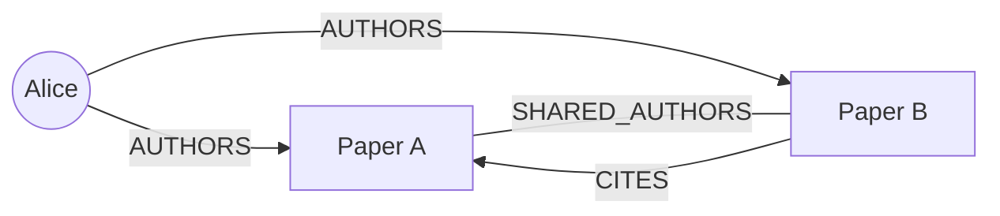
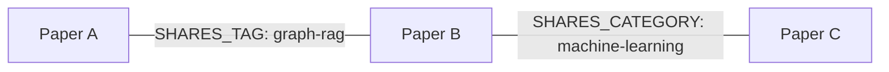

# ArXiv Curator — Requisiti e Piano di Azione

> Documento di contesto del progetto. Scopo: permettere a chiunque (umano o agente AI)
> di riprendere il lavoro da zero leggendo solo questo file. Aggiornarlo a ogni decisione
> architetturale rilevante e a ogni fase completata.

Ultimo aggiornamento: 2026-10-28 — Stato: **Ingestion ed enrichment implementati; bibliografia
da Scholar in batch con fallback OpenAlex, inclusi riferimenti esterni e metadati dei citati. HTML arXiv opzionale.
Due viste Obsidian concordate,
non ancora implementate. Verifica del nuovo metodo sul workspace da completare.**

---

## 1. Obiettivo del progetto

Sistema **agentico** (pipeline deterministica con **tool calling**) su Databricks che:

1. Riceve in input un **argomento** (query di ricerca) e dei **parametri**:
   - `num_papers`: numero N di paper da selezionare (top-N)
   - `ranking_criteria`: criterio di selezione — di default `relevance`, modificabile in
     `lastUpdatedDate` o `submittedDate` (con parametro `criteria_date` opzionale quando si filtra per data).
     *(Estensione futura: modulo separato per calcolare l'importanza tramite citazioni con tool esterni).*
2. Scarica da **arXiv** i top-N paper secondo il criterio (metadati + PDF).
3. Arricchisce i paper con un **LLM** via AI Gateway del corso (usando **tool calling / structured outputs** per estrarre tag tematici normalizzati, riassunto breve ed eventuali query/metadati).
4. Costruisce un **knowledge graph** che collega le entità tramite:
   - `SHARES_TAG`: collega paper che condividono tag LLM
   - `SHARES_CATEGORY`: collega paper che condividono categorie arXiv ufficiali
   - `CITES`: citazioni dirette tra paper (quando disponibili dai metadati/riferimenti)
   - `AUTHORS`: collega un nodo Autore (`Author`) al paper scritto (`Paper`)
   - `SHARED_AUTHORS`: collega paper che hanno uno o più co-autori in comune
5. Salva i dati strutturati in **Delta Tables** su Unity Catalog e gli **embeddings** in **Lakebase (`pgvector`)**.
6. Esporta nel **Volume Unity Catalog** due vault Obsidian autonomi (bibliografico e tematico),
   con un archivio `.zip` scaricabile contenente entrambi. I PDF saranno inclusi con link relativi.

### Estensibilità richiesta (design driver)

Il sistema deve essere pronto, senza refactoring strutturali, a supportare:

- **Altri indici bibliografici**: PubMed come primo esempio → pattern *provider* (`PaperSource`).
- **Calcolo importanza da citazioni**: modulo/tool separato aggiungibile in futuro per ri-ordinare o filtrare i paper in base all'impatto citazionale.
- **Ranking dei journal**: modulo di scoring separato che consuma i metadati raccolti.
- Nuovi criteri di selezione e nuovi tipi di nodi/edge nel grafo.

---

## 2. Vincoli: cosa NON toccare

- **Non modificare le versioni dell'ambiente**: `pyproject.toml` ha dipendenze pinnate e
  `requires-python = "==3.12.*"`. Aggiungere una dipendenza solo se strettamente necessaria
  e discuterla prima con l'utente; rigenerare `uv.lock` solo in quel caso.
- **Mantenere la struttura Databricks Asset Bundle**: `databricks.yml`, `resources/`,
  i tre target `dev`/`acc`/`prd` e il job `hello` esistente restano come sono.
  Le nuove risorse si **aggiungono**, non sostituiscono.
- Le regole ruff (`pyproject.toml`) e la CI (`.github/workflows/ci.yml`, pre-commit) restano
  attive: ogni nuovo codice deve passare lint + test.
- `project_config.yml` è la **fonte unica di verità** per catalog/schema/endpoint: mai
  hardcodare nomi di risorse nel codice, usare sempre `arxiv_curator.config.load_config`.
- `src/arxiv_curator/config.py` esiste già: non cambiarne l'API pubblica.
- Nota nota: `environment_version` è `"5"` in `pyproject.toml` e `"6"` in
  `resources/hello.job.yml`. Non "correggere": verificare col corso prima di toccarli.

### Risorse provisionate dal corso (da `project_config.yml` / README)

| Risorsa | Valore |
| --- | --- |
| Schemi UC | `llmops_{dev,acc,prd}.riccardo_tambone` (dev scrivibile; acc/prd read-only per me) |
| Volume suggerito | `arxiv_files` (da creare, es. `llmops_dev.riccardo_tambone.arxiv_files`) |
| LLM chat (AI Gateway) | `course_ops.gateway.chat` → GPT-OSS-120B, budget mensile per studente |
| Embeddings (AI Gateway) | `course_ops.gateway.embed` → GTE Large |
| SQL warehouse | `ce85f15d22846b60` |
| MLflow experiments | `/llmops/riccardo_tambone-{dev,acc,prd}` |
| Lakebase | `lb-llmops-riccardo-tambone` (condiviso tra env, 0.5–2 CU, suspend dopo 5 min idle; database e pgvector **da creare**) |
| Usage/budget policy id | `891ab3b2-3b04-3ccb-8359-9327a16ef424` |

Chiamate ai modelli: pacchetto `openai` (già nelle deps) con base URL del workspace
`/ai-gateway/mlflow/v1` e auth Databricks. `databricks-openai` NON è nelle deps — valutare
prima di aggiungerlo.

### Dipendenze già disponibili (rilevanti per il progetto)

`arxiv==2.3.1`, `pydantic`, `loguru`, `backoff`, `mlflow`, `openai`, `databricks-sdk`,
`databricks-agents`, `psycopg[binary]` + `psycopg-pool` (per Lakebase/pgvector),
`databricks-vectorsearch`, `pandas`, `pyarrow`.

---

## 3. Criteri di selezione e gestione metadati

- **Criteri nativi supportati subito (arXiv API)**:
  - `relevance` (**default**): ordinamento per rilevanza di arXiv (`arxiv.SortCriterion.Relevance`).
  - `lastUpdatedDate`: ordinamento per data di ultimo aggiornamento (`arxiv.SortCriterion.LastUpdatedDate`), con possibilità di passare un parametro data (`date_from` / `date_to` o data di riferimento).
  - `submittedDate`: ordinamento per data di prima sottomissione (`arxiv.SortCriterion.SubmittedDate`), con possibilità di passare un parametro data.
- **Modulo futuro per citazioni / importanza**:
  - Predisporre l'interfaccia `CitationEnricher` / `ImportanceScorer` (es. via Semantic Scholar / OpenAlex) come tool opzionale per arricchire gli archi `CITES` e calcolare uno score di importanza in una fase successiva.
- **Mai inventare citazioni via LLM**: gli edge `CITES` devono derivare da riferimenti bibliografici
  verificabili. Menzioni di titoli o ID nell'abstract/commenti non sono sufficienti.

---

## 4. Architettura proposta (Pipeline deterministica + Tool Calling)

```text
┌─────────────────────────────────────────────────────────────────────┐
│                  JOB BUNDLE (parametrizzato, nuovo)                 │
│  query, num_papers, ranking_criteria (default: relevance),          │
│  target_date (opz.), env                                            │
└──────────────────────────────┬──────────────────────────────────────┘
                               ▼
┌─────────────────────────────────────────────────────────────────────┐
│  1. INGESTION — sources/ (pattern Provider + Tool)                  │
│     ArxivSource.search(query, criteria, top_n, target_date)         │
│     + download PDF → UC Volume arxiv_files                          │
│     + salvataggio metadati grezzi/normalizzati → Delta table        │
└──────────────────────────────┬──────────────────────────────────────┘
                               ▼
┌─────────────────────────────────────────────────────────────────────┐
│  2. AGENT / ENRICHMENT (Pipeline deterministica con Tool Calling)   │
│     - LLM (course_ops.gateway.chat) invoca tool strutturati per:    │
│       1) raffinare/costruire query e filtri (opz.)                  │
│       2) estrarre tag tematici normalizzati + riassunto per paper   │
│     - Embedding abstract (course_ops.gateway.embed → GTE Large)     │
│     Metadati/Tag → Delta tables  |  Vettori → Lakebase pgvector     │
└──────────────────────────────┬──────────────────────────────────────┘
                               ▼
┌─────────────────────────────────────────────────────────────────────┐
│  3. GRAPH BUILDER — graph/                                          │
│     Nodi esportati: Paper e Author (bibliografico), Paper (tematico)│
│     Edge:                                                           │
│       - SHARES_TAG / SHARES_CATEGORY (paper ↔ paper)                │
│       - AUTHORS (author → paper)                                    │
│       - SHARED_AUTHORS (paper ↔ paper con co-autori comuni)         │
│       - CITES (paper → paper citato)                                │
│     Grafo materializzato in Delta tables (graph_nodes, graph_edges) │
└──────────────────────────────┬──────────────────────────────────────┘
                               ▼
┌─────────────────────────────────────────────────────────────────────┐
│  4. OBSIDIAN EXPORT — export/                                       │
│     - Note .md per Paper (frontmatter YAML con #tags + [[wikilinks]])│
│     - Due vault: bibliografico (paper/autori) e tematico (paper)    │
│     - Nessun graph.canvas (si usa il Graph View nativo di Obsidian) │
│     - UC Volume: due vault con PDF relativi + archivio .zip comune  │
└─────────────────────────────────────────────────────────────────────┘
```

### Struttura del package `src/autographrs/`

> Nota: `src/arxiv_curator/config.py` rimane intatto per il job di test `hello` e i test base del
> corso, mentre tutto il codice del nostro sistema vive in `src/autographrs/` (incluso nel wheel in
> `pyproject.toml`).

```text
autographrs/
├── config.py                # Re-export/wrapper di ProjectConfig, load_config, get_env
├── models.py                # Pydantic: Paper, Author, Tag, GraphNode, GraphEdge, SearchRequest
├── sources/
│   ├── base.py              # Protocol/ABC PaperSource (punto di estensione per PubMed, ecc.)
│   └── arxiv.py             # ArxivSource (relevance, lastUpdatedDate, submittedDate + filtro data)
├── enrichment/
│   ├── llm.py               # Client AI Gateway (chat + embeddings) + definizione Tools
│   ├── tagger.py            # Step deterministico con tool-calling per estrazione tag e summary
│   ├── citations.py         # Contratti, relazioni interne; Scholar batch con retry e tutti i citati
│   ├── citation_service.py  # Scholar primario, OpenAlex se nessun riferimento; diagnostica separata
│   ├── arxiv_html.py        # Provider opzionale: bibliografia HTML ufficiale
│   ├── openalex.py          # Fallback: riferimenti e metadati citati da OpenAlex
│   └── prompts/             # (pianificato) System/user prompt versionati
├── storage/
│   ├── delta.py             # Lettura/scrittura Delta tables su Unity Catalog
│   └── vector_db.py         # Gestione Lakebase Postgres + pgvector per embeddings
├── graph/
│   └── builder.py           # (pianificato) Nodi/archi bibliografici e tematici, incluso SHARES_CATEGORY
├── export/
│   └── obsidian.py          # (pianificato) Formatter Markdown, due vault con PDF e ZIP
├── ranking/
│   ├── importance.py        # (ESTENSIONE FUTURA) calcolo importanza da citazioni
│   └── journals.py          # (ESTENSIONE FUTURA) scoring venue/journal
└── pipeline.py              # Orchestrazione deterministica dei passi 1→4, entrypoint del job
```

Decisione chiave: **`PaperSource` è il punto di estensione** — PubMed sarà
`PubMedSource(PaperSource)` senza toccare la pipeline. Allo stesso modo, `ranking/importance.py`
e `ranking/journals.py` potranno essere agganciati come step/tool aggiuntivi.

---

## 5. Data model e storage

| Cosa | Dove | Note |
| --- | --- | --- |
| PDF dei paper | UC Volume `arxiv_files` | `<volume>/runs/<run_id>/pdfs/<arxiv_id>.pdf` |
| Metadati paper | Delta table `papers` | `arxiv_id`, `title`, `authors`, `abstract`, `published`, `updated`, `categories`, `pdf_path`, `run_id` |
| Arricchimento | Delta table `paper_enrichment` | `paper_id`, `title`, `authors`, `tags` LLM, `arxiv_category` umanizzate, `summary`, `run_id`, citazioni e stato lookup |
| Nodi e Archi grafo (pianificati) | Delta tables `graph_nodes`, `graph_edges` | Archi: `SHARES_TAG`, `SHARES_CATEGORY`, `CITES`, `AUTHORS`, `SHARED_AUTHORS` |
| Embeddings | Lakebase (`pgvector`) | Tabella `paper_embeddings` su `lb-llmops-riccardo-tambone` |
| Vault Obsidian + ZIP (pianificati) | UC Volume `arxiv_files` | Due cartelle vault e archivio comune nel percorso isolato della run |

Ogni nuova ricerca ha un `run_id` (timestamp + slug argomento + UUID): lo stesso paper puo'
comparire in run diverse senza essere un duplicato logico. Lo storico resta nelle tabelle e nel Volume.

### Isolamento, pubblicazione e retry delle run (implementato)

- Registro Delta `pipeline_runs`, chiave `run_id`: parametri (`request_json`, source, opzioni),
  `attempt_id`, stato `RUNNING`/`COMPLETED`/`FAILED`, stati ingestion/enrichment/export,
  checkpoint `selection_complete`, conteggi paper/PDF/enrichment, warning, errore e timestamp.
  Percorsi vault/ZIP predisposti ma non ancora valorizzati; export `NOT_IMPLEMENTED`.
- `papers` e `paper_enrichment` sono scritte con `MERGE` e chiave `(run_id, source, paper_id)`.
  Aggiunta `source` all'enrichment; se manca nella tabella preesistente viene aggiunta prima
  del MERGE, poiche' una nuova colonna nella clausola ON richiede uno schema gia' compatibile.
- Deduplicazione delle righe sorgente identiche; duplicati conflittuali o storici respinti
  con errore esplicito, non riparati arbitrariamente. Nessuna cancellazione dello storico globale.
- Una run e' un singolo snapshot: i lettori filtrano `run_id` e abbinano `source`/`paper_id`.
  `load_papers`, `load_enrichments`, `load_run_dataset` verificano pubblicazione, unicita',
  conteggi, copertura esatta delle chiavi e ordine `rank`; vietate letture implicite di "ultima run".
- Il registro e' una barriera di pubblicazione, non una transazione multi-tabella: solo
  dopo tutte le scritture e le verifiche la run diventa `COMPLETED`. Eccezioni registrate e rilanciate.
- Run con citazioni non disponibili completabile con warning, conservando `citation_status`;
  PDF richiesti ma non scaricati fanno invece fallire la run. Enrichment disabilitato:
  `SKIPPED`, consultabile tramite `load_papers` ma non come dataset arricchito.
- Parametro job `run_id` vuoto: nuova ricerca. Valorizzato: retry di una run `FAILED` con
  gli stessi parametri/opzioni/fonte. Run sconosciute, completate o attive non sono riutilizzabili.
- Retry: riusa selezione finalizzata e PDF presenti, aggiorna le stesse chiavi; enrichment
  puo' richiamare LLM e provider. Se la selezione non era stata checkpointata, elimina solo
  le righe paper di quella run non pubblicata e rifà la ricerca.
- Job serializzato con `max_concurrent_runs: 1`; checkpoint condizionati all'`attempt_id`
  attivo. Non eseguire writer esterni concorrenti sullo stesso ID: Delta non impone unicita'
  delle chiavi. Interruzioni forzate possono lasciare `RUNNING`; nessun recupero automatico
  che rischi di rubare una run attiva. Riconciliare solo dopo aver verificato il job terminato.
- Le run precedenti senza registro non vengono implicitamente pubblicate o migrate.
  Per la prova creare una nuova run. Il notebook verifica anche la rilettura del dataset pubblicato.

### Output concordato: dataset comune, due proiezioni Obsidian

Questa decisione sostituisce la precedente proposta di vault unico con nodi Tag.
L'utente sceglie la visualizzazione aprendo il vault corrispondente, senza plugin o Canvas.

```text
output.zip
  bibliographic_vault/
    index.md
    papers/
    authors/
    attachments/
  thematic_vault/
    index.md
    papers/
    attachments/
```

**Vista bibliografica / collaborazioni:**

- Nodi Paper e Autore.
- `AUTHORS`: Autore -> Paper, identita' degli autori basata su ID affidabili quando disponibili;
  un match solo sul nome resta un'associazione non disambiguata, non una certezza.
- `SHARED_AUTHORS`: Paper -- Paper, con elenco degli autori condivisi come evidenza.
- `CITES`: Paper citante -> Paper citato, mai un arco inverso inventato.
- Grafo bibliografico aperto: includere anche i citati fuori dalla selezione e da arXiv,
  usando `bibliography`; `num_papers` limita soltanto i paper iniziali.
  Voci prive di identita' certa mantengono un placeholder distinto e il testo originale.
  Nessun download/LLM o espansione ricorsiva automatica sui riferimenti esterni.
- Scopo: esplorare collaborazioni, continuita' tra lavori e dipendenze bibliografiche.
- Sezioni delle note: Autori, Paper con autori condivisi, Cita e Citato da.



**Vista tematica:**

- Nodi Paper; link diretti Paper -- Paper tramite `SHARES_TAG` e `SHARES_CATEGORY`.
- Ogni arco conserva i tag/categorie condivisi e il loro conteggio, per spiegare il collegamento.
- `tags` contiene solo temi estratti dall'LLM; `arxiv_category` solo categorie arXiv umanizzate
  usando la tassonomia ufficiale. Non mescolare le due colonne.
- Conservare separati i tipi di arco per consentire esportazioni per tag, categorie o entrambe.
- Nessuna nota Tag/Categoria dedicata in questa vista: i temi restano proprieta' delle note.
  I tag nativi possono essere nascosti nel Graph View per mantenere i paper come nodi principali.
- Valutare limiti/filtro per categorie molto generiche, evitando un grafo tutto-connesso.



**Formattazione comune delle note (da implementare):**

- Una funzione deterministica genera frontmatter YAML e corpo Markdown da dati strutturati.
- Includere titolo, identificatore stabile, autori, date, fonte, DOI/URL, abstract originale,
  summary LLM separata e chiaramente marcata, tag e categorie distinti, link relativo al PDF.
- Stesso paper/metadati nei due vault; cambiano solo le sezioni e i collegamenti della vista.
- Nessun `key_contributions`. PDF inclusi in ogni vault per renderlo autonomo sul PC.
- Nomi file stabili e sanificati, collisioni gestite tramite identificatori.
- Pubblicazione completa dopo generazione riuscita e ZIP scaricabile dal Volume UC.
- Il Graph View nativo non mostra automaticamente etichette/tipi di relazione sugli archi.
  Direzione ed evidenze devono restare esplicite nelle note e nelle tabelle.
- Attenzione alla sezione "Citato da": inserire il wikilink inverso crea un ulteriore link
  Obsidian. Decidere in fase export se usare backlink nativi per non suggerire citazioni inverse.
- Anche indice, PDF e proprieta' con wikilink possono aggiungere nodi al Graph View:
  predisporre filtri per mostrare i soli tipi utili all'analisi.

### Citazioni: Scholar batch, fallback OpenAlex e bibliografia aperta (implementato)

- Contratto paper-aware `fetch_for_paper(Paper)`: il resolver riceve fonte, ID locale,
  DOI e URL. Per fonti diverse da arXiv cerca DOI o landing URL esatto, mai l'ID locale
  come arXiv. Mantiene l'interfaccia arXiv legacy per compatibilita' e rifiuta l'uso dei
  provider arXiv-only su altri repository. Test di ingresso non-arXiv e persistenza completati.
- Contratto bulk `fetch_papers(list[Paper])` prioritario per Scholar e servizio predefinito:
  usa blocchi da 100 ID (`batch_size`, massimo API 500, risposta max 10 MB) e non esegue un
  ciclo retry separato per ogni paper.
  Scholar accetta ARXIV, DOI, PMID numerico o URL a seconda di fonte e metadati.
- Tassonomia arXiv applicata soltanto a `source=arxiv`; categorie di altre fonti conservate
  come metadati originali, `arxiv_category` vuoto e tag LLM indipendenti. Il job resta su
  arXiv; implementazione di PubMedSource e ricerca federata restano estensioni future.
- Provider predefinito Scholar: conserva tutti i riferimenti, con ID Scholar/DOI/arXiv,
  titolo, autori, anno e placeholder per voci senza identita'. Pagina le liste incomplete.
  Target `scholar:<id>`; nessuna eliminazione dei citati esterni ad arXiv.
- Prima iterazione identita' autori: `paper_enrichment.authorships` e
  `bibliography[].authorships` conservano nome, posizione nella lista del provider,
  identificativi Scholar/OpenAlex/ORCID quando disponibili, provider e URL di evidenza.
  Nessuna chiamata aggiuntiva per autore, nessuna ricerca ORCID per nome e nessuna fusione
  tra provider o per omonimia. I nomi `authors` esistenti restano invariati.
  Il fallback conserva separatamente le attribuzioni del paper di entrambi gli indici.
  Valori mancanti/storici/HTML null; nessun backfill. Riconciliazione demandata al grafo.
- Retry Scholar: 4 tentativi, pacing 1,1s, 429 senza Retry-After con backoff 10/20/40s
  piu' jitter; trasporto/5xx da 2s. Rispetta Retry-After numerico/HTTP-date entro 60s
  e budget condiviso di 90s di attese retry per bulk (pacing e timeout esclusi).
  Budget non azzerato a ogni pagina. Batch esaurito: salta quelli restanti; errore
  di paginazione: conserva dati acquisiti e blocca nuove paginazioni nello stesso bulk.
  API key opzionale `SEMANTIC_SCHOLAR_API_KEY` da secret, mai nei log o parametri job.
- OpenAlex viene chiamato soltanto quando Scholar non restituisce alcuna voce.
  Nessuna fusione/riconciliazione globale: dati Scholar parziali ma utili restano conservati.
  `citation_lookups` registra fonte/stato/errore/timestamp per entrambi i provider; warning
  del primario non nascosti se il fallback riesce. `citation_source` indica il risultato scelto.
  `citation_paper_ids` conserva gli URL identificativi del paper citante nei provider risolti,
  inclusa l'identita' Scholar se il risultato bibliografico finale proviene dal fallback.
- Provider fallback OpenAlex: identifica la fonte tramite location arXiv verificata;
  include URL HTTP/HTTPS e DOI arXiv `10.48550/arxiv.<id>` (forme distinte nell'indice).
  fallback sul DOI gia' disponibile nei metadati se il match arXiv manca.
  Nessun match soltanto per titolo o scelta arbitraria fra candidati ambigui.
- Recupera `referenced_works` e metadati dei citati in batch fino a 100 ID, con cache
  nella run. Conserva tutti gli ID di destinazione anche se alcuni metadati non arrivano.
- `paper_enrichment.bibliography`: array con ID/posizione, testo (titolo o ID per OpenAlex),
  URL, ID arXiv, DOI, `target_id`, `match_method`, `evidence_url`, `provider_id`, titolo,
  autori e anno. Non e' la citazione testuale originale ne' l'ordine originale del PDF.
- Target `openalex:<W-id>` anche fuori da arXiv e dalla selezione; evidenza sul lavoro
  citante nell'indice. Nessun filtro che scarti riferimenti perche' privi di ID arXiv.
- Richieste seriali con pacing e retry limitati su trasporto/429/5xx, rispetto di Retry-After
  entro budget. `OPENALEX_API_KEY` opzionale da secret del processo, mai nei parametri job.
- Stati espliciti. Metadati mancanti OpenAlex: `partial` con ID conservati;
  fonte non identificata: `not_found`; quota esaurita: `rate_limited`. Errori e dati parziali
  producono warning. `ok` non certifica copertura completa della bibliografia originale.
- Lavoro trovato con zero riferimenti indicizzati: `partial` e warning di copertura
  sconosciuta, non successo con bibliografia dichiarata vuota.
- Verifica correttiva locale sugli ID della run: `2412.05830` recupera 31 riferimenti
  (30 con titolo); `2410.12096`, `2501.05032`, `2406.16167`, `2405.11357` vengono trovati
  tramite le location alternative ma al momento restituiscono zero riferimenti nell'indice.
- Ingestion ed enrichment si fermano a `bibliography`: non calcolano relazioni.
  Il futuro graph builder indipendente ricostruira' gli archi dalle bibliografie salvate,
  inclusi i citati esterni. Le vecchie colonne `referenced_arxiv_ids`, `cites_in_set`,
  `cited_by_in_set` e `papers.cited_paper_ids` non vengono piu' prodotte o lette;
  eventuali colonne e valori storici Delta rimangono senza migrazione o backfill.
- I tre provider sono anche selezionabili esplicitamente in Python.
  HTML non e' un fallback automatico. Nessun servizio PDF o nuova dipendenza.
- Metadata e riferimenti sono snapshot della run; nessuna espansione ricorsiva, download
  o arricchimento LLM dei citati. Riconciliazione multi-provider globale futura.
- Schema Spark nested esplicito ed evoluzione Delta, attributi nuovi null nello storico.
  Nessun backfill: nuova run per verificare il provider. Export nodi/archi ancora da implementare.
- Prova reale locale del 2026-10-28 sul paper senza HTML `2610.00223`: trovato il lavoro
  `W4285240123`, 34 riferimenti, 33 con titolo/autori/DOI, un ID conservato senza metadati;
  stato `partial`. Verifica sul workspace Databricks ancora da eseguire.
- Prova reale adapter Scholar aggiornata: due 429 recuperati dopo circa 11s/21s;
  73/43/20/18/24 riferimenti conservati per cinque paper, inclusi citati senza ID arXiv.
  Prova del servizio completo su `2412.05830`: Scholar vuoto, fallback OpenAlex con
  31 riferimenti (30 titoli), entrambi gli esiti diagnostici conservati.

---

## 6. Asset Bundle: nuove risorse (senza toccare l'esistente)

Risorsa attuale `resources/ingest_papers.job.yml`:

- Job `job-ingest-papers`, serverless,
  `environment_version: "5"` (coerente con `pyproject.toml`), dipendenza dal wheel
  `../dist/*.whl`, `budget_policy_id: "891ab3b2-3b04-3ccb-8359-9327a16ef424"`.
- Task notebook `resources/deployment_notebooks/ingest_papers.py` con parametri anche nella GUI Jobs:
  - `topic`: argomento di ricerca
  - `num_papers`: numero di paper (default `10`)
  - `ranking_criteria`: `relevance` (default) | `lastUpdatedDate` | `submittedDate`
  - `criteria_date`: data opzionale (es. `YYYY-MM-DD` o range) quando si usa `lastUpdatedDate` / `submittedDate`
  - `env`: `${bundle.target}`
- Il job di test `hello` (`resources/hello.job.yml`) resta intatto.

---

## 7. Roadmap per fasi

| Fase | Contenuto | Criterio di completamento | Stato |
| --- | --- | --- | --- |
| **0 — Setup infrastruttura** | Creare volume UC `arxiv_files`; configurare database su Lakebase e abilitare estensione `pgvector` | Volume e tabella `pgvector` raggiungibili da dev | Volume gestito via `ensure_volume_exists()`; Lakebase da fare in Fase 3 |
| **1 — Dominio & Ingestion arXiv** | `models.py`, `sources/base.py`, `sources/arxiv.py` (`relevance`, `lastUpdatedDate`, `submittedDate` + filtro data); test unitari offline | `ArxivSource` ritorna top-N paper + scarica PDF; pytest e ruff verdi | ✅ Completata |
| **2 — Persistenza Delta & Volume** | `storage/delta.py` (tabella `papers` + Volume UC), `pipeline.py` (`run_ingestion`), job `ingest_papers.job.yml` | Scrittura/lettura Delta e salvataggio PDF su Volume funzionanti e testati | ✅ Completata |
| **3 — Enrichment con Tool Calling & Citazioni** | Tag/categorie distinti; Scholar batch con retry limitati, fallback OpenAlex e citati esterni con diagnostica provider | Test offline e verifica provider sul workspace | Implementata; verifica live Databricks da completare. MLflow/embeddings restano da fare |
| **4 — Knowledge Graph Builder** | `AUTHORS`, `SHARED_AUTHORS`, `CITES`, `SHARES_TAG`, `SHARES_CATEGORY` e tabelle Delta | Archi tipizzati con evidenze, due proiezioni del dataset | ⏳ Prossima |
| **5 — Esportatore Obsidian + ZIP** | Formatter comune, vault bibliografico e tematico autonomi con PDF, senza `.canvas` | Due vault con link validi e ZIP nel Volume UC | ⏳ Da fare |
| **6 — Pipeline End-to-End & Bundle** | Estensione `pipeline.py` a tutti gli step 1→4 | `databricks bundle validate -t dev` e run end-to-end su dev completati | ⏳ Da fare |
| **7 — Estensioni future** | Modulo calcolo importanza da citazioni (`ranking/importance.py`), nuovo indice `PubMedSource`, ranking dei journal (`ranking/journals.py`) | Estensioni aggiunte tramite i contratti base senza modificare il core | ⏳ Da fare |

---

## 8. Aspetti LLMOps (richiesti dal corso)

- **MLflow Tracking & Tracing**: loggare per ogni run su `/llmops/riccardo_tambone-{env}`:
  parametri (`query`, `num_papers`, `ranking_criteria`, `target_date`), metriche (n. paper
  scaricati, n. nodi/archi per tipo, token consumati), tracce delle chiamate tool-calling LLM e
  path del `.zip` generato.
- **Tool Calling deterministico**: l'LLM non esegue codice libero; la pipeline gli fornisce
  schema/tool definiti (es. `record_paper_analysis`, `extract_citations`) validati con Pydantic.
- **Prompt Versioning**: prompt salvati in `enrichment/prompts/` e tracciati con la run.
- **Resilienza**: `backoff` sulle chiamate API arXiv e AI Gateway; se l'LLM fallisce su un singolo
  paper, il paper viene comunque incluso nel grafo usando le categorie arXiv native.

---

## 9. Decisioni architetturali consolidate

1. **Architettura agentica**: **Pipeline deterministica con Tool Calling** (niente loop autonomi imprevedibili; step chiari e tracciabili su MLflow).
2. **Ordinamento e selezione**: default `relevance`, selezionabili `lastUpdatedDate` e `submittedDate` (con parametro data). Il calcolo dell'importanza tramite citazioni sarà un modulo/tool futuro separato.
3. **Storage**: **Opzione A** — Metadati, arricchimenti e grafo salvati in **Delta Tables** su Unity Catalog; embeddings salvati su **Lakebase (`pgvector`)**.
4. **Relazioni del Knowledge Graph**: `SHARES_TAG`, `SHARES_CATEGORY`, `CITES`, `SHARED_AUTHORS`, `AUTHORS`.
5. **Formato Obsidian**: due vault autonomi (bibliografico con Paper/Autori; tematico con Paper),
   formatter comune con abstract e metadati, PDF relativi e ZIP scaricabile. Nessun Canvas/plugin
   richiesto e nessuna nota Tag obbligatoria nella vista tematica. Dettagli in sezione 5.
6. **Ambiente Databricks**: `hello.job.yml` lasciato intatto come job di test; il nuovo job userà la stessa configurazione serverless.

---

## 10. Istruzioni per riprendere il contesto

1. Rileggere questo file per intero.
2. Controllare `git status` per modifiche dell'utente: non sovrascriverle.
3. Verificare lo stato delle fasi nella tabella §7 (aggiornarla a ogni avanzamento).
4. Non considerare implementato nulla di pianificato finché non è nel codice con test.
5. Prima di cambiare versioni, lockfile, target del bundle o risorse provisionate:
   chiedere all'utente.
